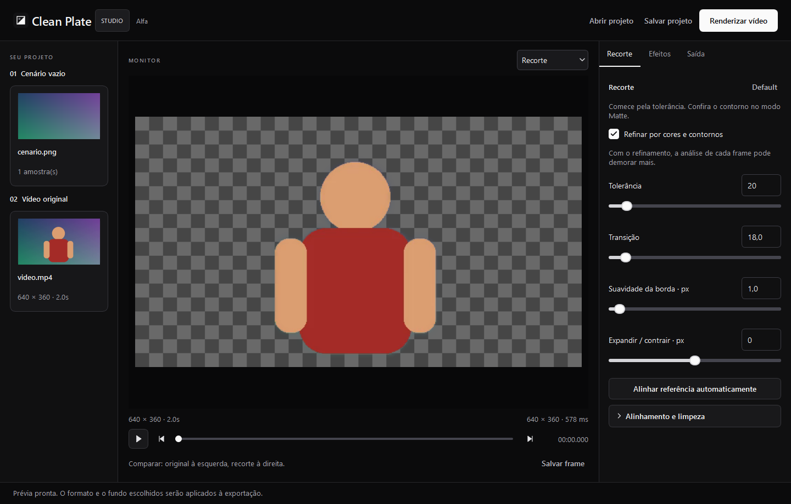

<p align="center">
  
</p>

<h1 align="center">Clean Plate Studio</h1>

<p align="center">Recorte imagens e vídeos usando uma referência do cenário vazio.</p>
<p align="center"><strong>Alfa</strong> · Windows · Python / Qt · CLI / MCP</p>

## Começar

No Windows, instale [Python 3.11 de 64 bits](https://www.python.org/downloads/windows/) e [FFmpeg](https://ffmpeg.org/download.html). Deixe `ffmpeg` e `ffprobe` no PATH. Na pasta do projeto:

```powershell
python -m venv .venv
.\.venv\Scripts\python.exe -m pip install -r requirements-desktop.txt
.\.venv\Scripts\python.exe -m cleanplate.desktop
```

Já tem o pacote compilado? Abra `Clean Plate Studio.exe` e mantenha `_internal` e `bin` ao lado dele. O pacote inclui Python e FFmpeg.



## Usar

Adicione uma foto ou um take do cenário vazio e depois o vídeo original. Ajuste o recorte na prévia, escolha o formato na aba **Saída** e clique em **Renderizar vídeo**.

Use **Matte** para conferir a máscara e **Comparar** para ver original e resultado lado a lado. Os botões **Default**, em **Recorte** e **Efeitos**, restauram seus grupos de ajustes.

| Saída | Formato | Resultado |
|---|---|---|
| Transparência | MOV / ProRes 4444 | Vídeo com canal alpha |
| Fundo sólido | MP4 / H.264 | Preto, branco, verde chroma ou outra cor RGB |
| Fundo desfocado | MP4 / H.264 | Cenário com desfoque ajustável |
| Matte | MP4 / H.264 | Máscara em tons de cinza |
| Salvar frame | PNG | Frame atual na resolução original |

Áudio opcional nas saídas de vídeo, exceto matte. O [guia do aplicativo](LEIA-ME-APP.md) descreve os controles.

## Recursos

- Alinhamento automático da referência e ajuste manual de posição, escala e rotação.
- Compensação de luz, refinamento por cores e contornos e limpeza da máscara.
- Expansão, contração e suavização das bordas; preenchimento de pequenas falhas.
- Borda, sombra e glow com ativação independente.
- Projetos JSON, renderização com progresso e cancelamento, CLI e servidor MCP.

O motor compara o vídeo com a referência e refina o recorte com as cores do frame, sem modelo pré-treinado. Trabalhe com câmera fixa, cenário estático e mídia SDR.

## Atalhos e terminal

| Controle | Ação |
|---|---|
| `Ctrl+O` | Abrir vídeo ou imagem |
| `Ctrl+S` | Salvar projeto |
| Setas, com a barra de tempo em foco | Navegar pelo vídeo |
| **Default**, em Recorte | Restaurar recorte, alinhamento e limpeza |
| **Default**, em Efeitos | Restaurar valores e desligar os efeitos |

Para usar o terminal e o MCP:

```powershell
.\.venv\Scripts\python.exe -m pip install -r requirements-automation.txt
.\.venv\Scripts\python.exe -m cleanplate --help
.\.venv\Scripts\python.exe -m cleanplate preview demo/projeto.json output/previa.png
```

| Comando | Ação |
|---|---|
| `probe` | Consultar resolução, orientação e duração |
| `create`, `inspect`, `update` | Criar, consultar e editar projetos |
| `align` | Alinhar a referência ao frame escolhido |
| `preview`, `frame` | Salvar prévia ou frame |
| `render` | Renderizar o projeto |
| `job-start`, `job-status`, `job-list`, `job-cancel` | Controlar renderizações em segundo plano |
| `mcp` | Iniciar o servidor por stdio |

O pacote de terminal usa `CleanPlateControl.exe`. Veja [Terminal e MCP](AUTOMATION.md) e a [referência dos comandos](skills/cleanplate-control/references/commands.md).

## Compilar

No mesmo ambiente Python, com FFmpeg e FFprobe no PATH:

```powershell
.\.venv\Scripts\python.exe -m pip install -r requirements-build.txt
.\.venv\Scripts\python.exe -m unittest discover -s tests -v
.\.venv\Scripts\python.exe tools/build_desktop.py
.\.venv\Scripts\python.exe tools/build_control.py
```

Os pacotes ficam em `dist/Clean Plate Studio/` e `dist/CleanPlateControl/`. Para gravar o aplicativo em outra pasta, use `tools/build_desktop.py --dist-dir output/packages`. Feche a cópia que será substituída antes de recompilar.

O exemplo em `demo/` usa mídia sintética e caminhos relativos. Abra `demo/projeto.json` pelo código-fonte ou `Exemplo/exemplo.json` no pacote. Para gerar a mídia novamente, execute `tools/create_demo.py`.

## Licença

Código do projeto sob [MIT](LICENSE). As dependências mantêm suas [licenças próprias](THIRD_PARTY.md).
